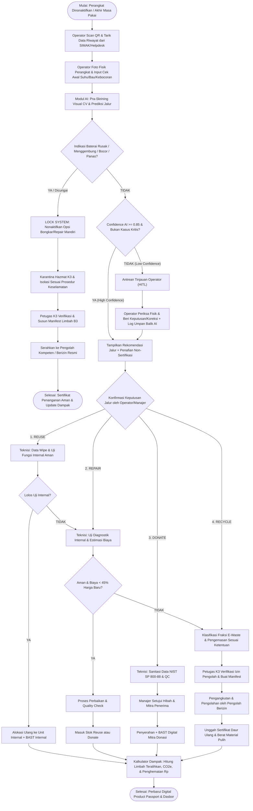
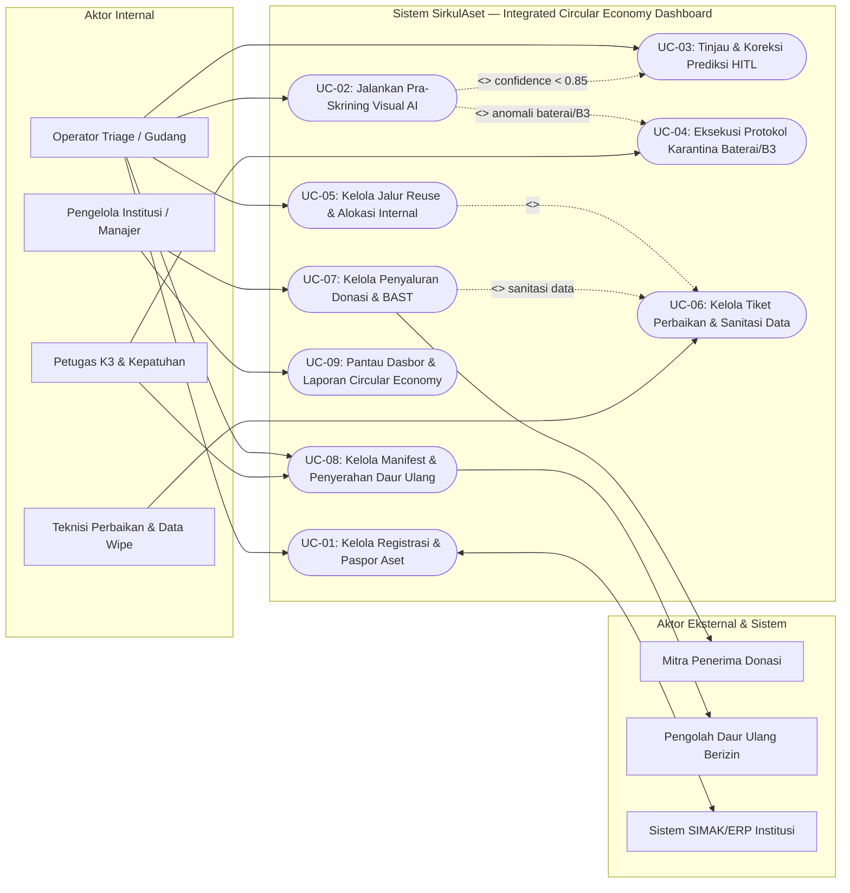
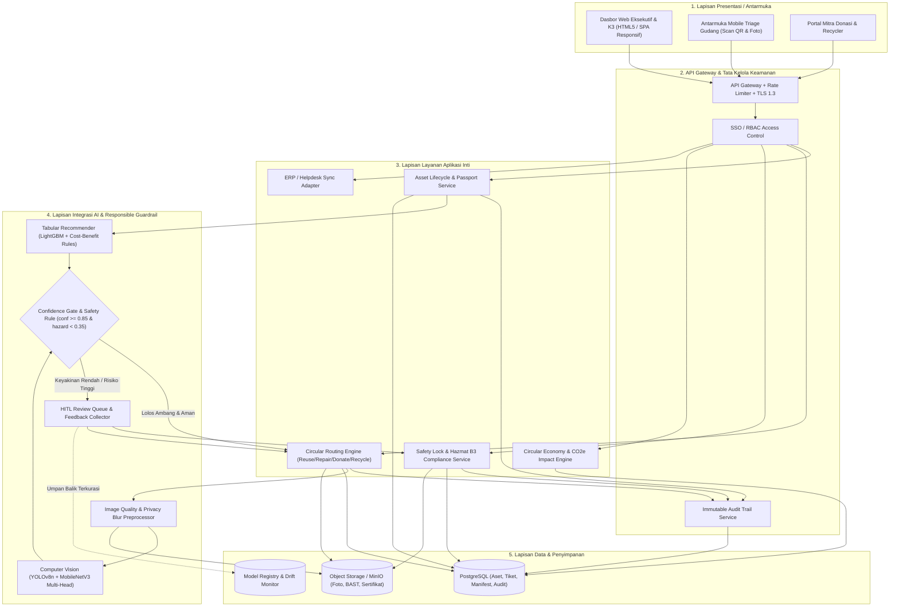
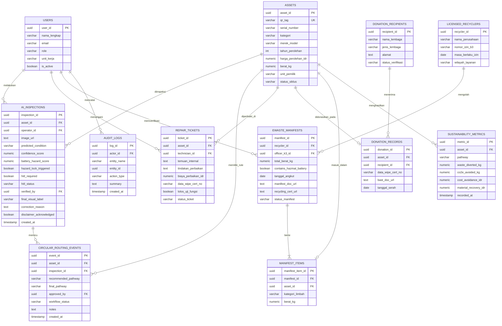

# Rancangan Solusi Sistem: SirkulAset — Integrated Circular Economy Dashboard

**Mata Kuliah:** Green Computing & Sustainable AI (Pertemuan 10)  
**Studi Kasus No. 25:** *Integrated Circular Economy Dashboard*  
**Fokus Solusi:** Pemantauan menyeluruh aset dan limbah elektronik (*e-waste*) institusi pada jalur **Digunakan Kembali (*Reuse*)**, **Diperbaiki (*Repair*)**, **Didonasikan (*Donate*)**, dan **Diserahkan ke Pengolah Daur Ulang Berizin (*Recycle*)**, dengan tata kelola **Keselamatan K3 & Responsible AI (*Human-in-the-Loop*)**.

---

## Ringkasan Eksekutif & Nilai Kebaruan Solusi

Pengelola institusi (seperti perguruan tinggi, rumah sakit, kementerian/lembaga, maupun korporasi multi-gedung) menghadapi tantangan besar dalam melacak nasib ribuan perangkat elektronik setelah masa pakai utamanya berakhir. Selama ini, pencatatan pengadaan terpisah dari tiket pemeliharaan dan proses penghapusan barang (*disposal*), sehingga perangkat yang masih layak pakai sering menumpuk di gudang (*hibernating stock*), sedangkan limbah baterai/elektronik berisiko ditangani secara tidak aman.

**SirkulAset** dirancang sebagai **Control Tower Ekonomi Sirkular Terintegrasi** yang memadukan manajemen siklus hidup aset, *AI Visual Pre-Screening* berbasis *Computer Vision* ringan (*Green AI*), mesin rekomendasi rute sirkular, protokol keselamatan baterai/B3 terkunci, serta pelacakan *Chain-of-Custody* hingga ke mitra donasi dan pengolah daur ulang berizin.

### Nilai Kebaruan (Inovasi) Utama
1. **Orkestrasi 4 Jalur Sirkular + Karantina Hazmat dalam Satu Dasbor:** Menghubungkan jalur *Reuse*, *Repair*, *Donate*, dan *Recycle* beserta jalur khusus *Hazmat Quarantine* dalam satu *Digital Product Passport* per perangkat.
2. **Safety-First & Human-in-the-Loop (HITL) AI Architecture:** *Computer Vision* secara ketat dibatasi hanya sebagai **pra-skrining visual awal** (*non-certification*), dilengkapi *Confidence Gate* (`threshold >= 0.85`) dan *Battery Hazard Guardrail* (`hazard_score >= 0.35`) yang mengunci tindakan pembongkaran mandiri dan memaksa peninjauan operator/petugas K3.
3. **Green & Sustainable AI Engineering:** Memilih arsitektur model ringan (*YOLOv8n* + *MobileNetV3-Large* + *LightGBM*) agar konsumsi energi komputasi inferensi tetap rendah dibandingkan model *vision-language* berukuran besar.
4. **Kalkulator Dampak Terukur Berbasis Hierarki Sirkular:** Menghitung pengurangan timbulan limbah ($\text{kg}$), emisi karbon yang dihindari ($\text{kg CO}_2\text{e}$), serta penghematan belanja modal (*CapEx cost avoidance*) secara langsung dari transaksi terverifikasi.

---

## 1. Identifikasi Masalah

### 1.1 Latar Belakang
Institusi skala menengah hingga besar mengelola ribuan unit perangkat Teknologi Informasi dan Komunikasi (TIK) serta elektronik penunjang (laptop, PC desktop, monitor, proyektor, printer, perangkat jaringan, serta UPS/baterai). Siklus pembaruan perangkat setiap 3–5 tahun menghasilkan arus keluar perangkat dalam jumlah besar setiap semester. Tanpa sistem pemantauan terpadu:
- **Silo Data Siklus Hidup:** Sistem inventaris barang milik institusi hanya mencatat status "Aktif" atau "Dihapuskan", tanpa merekam apakah perangkat tersebut sebenarnya dipakai ulang di unit lain, diperbaiki, dihibahkan, atau diserahkan ke pengolah berizin.
- **Triage Gudang yang Lambat dan Subjektif:** Petugas gudang/IT memeriksa ratusan perangkat bekas secara manual tanpa standar penilaian visual yang konsisten, sehingga perangkat bernilai tinggi sering terlambat dialokasikan (*idle depreciation*).
- **Risiko Keselamatan Kerja pada Komponen Baterai & B3:** Perangkat dengan baterai *lithium-ion* atau aki UPS yang rusak, menggembung (*swollen*), bocor, atau panas berpotensi memicu *thermal runaway* (kebakaran/ledakan) serta paparan bahan beracun berbahaya (B3) apabila dibongkar secara mandiri oleh staf non-kompeten.
- **Kesenjangan Akuntabilitas Lingkungan & Regulasi:** Pengelola institusi kesulitan memenuhi tuntutan pelaporan keberlanjutan (*ESG/Green Campus*) dan pembuktian kepatuhan regulasi pengelolaan limbah spesifik dan B3 (mengacu pada prinsip PP No. 27 Tahun 2020 tentang Pengelolaan Sampah Spesifik serta PP No. 22 Tahun 2021 tentang Penyelenggaraan Perlindungan dan Pengelolaan Lingkungan Hidup).

### 1.2 Rumusan Masalah
1. Bagaimana merancang satu dasbor terpusat yang memberikan visibilitas menyeluruh dan *real-time* atas aset elektronik institusi di seluruh jalur **Reuse**, **Repair**, **Donate**, dan **Recycle**?
2. Bagaimana memanfaatkan teknologi AI (*Computer Vision* dan analitik prediktif) untuk mempercepat identifikasi awal kondisi perangkat dan rekomendasi jalur sirkular tanpa mengorbankan akurasi, transparansi, dan energi komputasi?
3. Bagaimana memastikan batas tanggung jawab AI dan keselamatan operasional diterapkan secara ketat dalam sistem, khususnya larangan pembongkaran mandiri baterai berisiko serta kewajiban verifikasi manusia (*Human-in-the-Loop*) pada prediksi berkeyakinan rendah?
4. Bagaimana mengukur dan membuktikan kontribusi nyata pengelolaan aset elektronik terhadap pengurangan limbah elektronik, emisi karbon, dan efisiensi ekonomi institusi?

---

## 2. Analisis Kebutuhan

### 2.1 Kebutuhan Fungsional (Functional Requirements)

| Kode | Nama Kebutuhan | Deskripsi Fungsional |
| :--- | :--- | :--- |
| **FR-01** | **Registrasi & Paspor Digital Aset** | Sistem mencatat identitas perangkat (QR/Asset Tag, nomor seri, kategori, merek/model, tahun perolehan, bobot, nilai perolehan, unit pemilik) dan membentuk *Digital Product Passport* sepanjang siklus hidupnya. |
| **FR-02** | **Dasbor Eksekutif Ekonomi Sirkular** | Sistem menampilkan KPI utama secara agregat dan terfilter (total aset terkelola, *Circularity Rate %*, distribusi unit & massa pada jalur *Reuse, Repair, Donate, Recycle*, tren bulanan, serta peringatan antrean HITL & karantina K3). |
| **FR-03** | **Pra-Skrining Visual AI** | Operator dapat mengunggah foto fisik perangkat; modul AI melakukan deteksi jenis perangkat, kerusakan eksternal, serta indikasi visual anomali baterai (menggembung/bocor/korosi) beserta *confidence score* dan *bounding box*. |
| **FR-04** | **Rekomendasi Jalur Sirkular** | Sistem menggabungkan hasil skrining visual, usia perangkat, riwayat tiket perbaikan, dan estimasi nilai sisa untuk merekomendasikan jalur terbaik (*Reuse, Repair, Donate,* atau *Recycle*). |
| **FR-05** | **Antrean Tinjauan Operator (HITL)** | Prediksi dengan `confidence_score < 0.85`, hasil ambigu, atau keputusan berisiko (penghapusan aset/donasi) otomatis tertahan pada antrean verifikasi operator dan tidak dapat dieksekusi otomatis. |
| **FR-06** | **Protokol Keselamatan & Karantina Baterai/B3** | Jika terdeteksi indikasi baterai menggembung, bocor, atau panas (baik dari AI maupun laporan operator), sistem mengunci opsi "Repair/Bongkar Mandiri", mewajibkan isolasi sesuai SOP K3, dan mengarahkan penyerahan ke petugas kompeten/pengolah berizin. |
| **FR-07** | **Manajemen Alur Kerja 4 Jalur** | Sistem mendukung pengelolaan status spesifik tiap jalur: alokasi ulang internal (*Reuse*), tiket uji fungsi & servis (*Repair*), verifikasi sanitasi data NIST SP 800-88 & BAST hibah (*Donate*), serta pengemasan batch & manifest limbah (*Recycle*). |
| **FR-08** | **Verifikasi Mitra & Pengolah Berizin** | Sistem menyimpan dan memvalidasi masa berlaku izin pengolah/pengangkut e-waste B3 serta status verifikasi lembaga penerima donasi sebelum penyerahan disetujui. |
| **FR-09** | **Kalkulator & Ekspor Laporan Dampak** | Sistem menghitung $\text{kg}$ e-waste teralihkan dari TPA, $\text{kg CO}_2\text{e}$ terhindarkan, dan nilai penghematan biaya (*Rp*), serta mengekspor laporan audit/keberlanjutan. |
| **FR-10** | **Jejak Audit (*Immutable Audit Log*)** | Setiap perubahan status, rekomendasi AI, koreksi operator HITL, persetujuan manajer, serta unggahan manifest/sertifikat tercatat dengan timestamp dan identitas aktor. |

### 2.2 Kebutuhan Nonfungsional (Nonfungsional Requirements)

| Kode | Kategori | Spesifikasi Target |
| :--- | :--- | :--- |
| **NFR-01** | **Keselamatan & Tata Kelola AI** | Seluruh halaman skrining AI wajib menampilkan penafian bahwa CV hanya bersifat identifikasi visual awal (bukan sertifikasi keamanan/kondisi internal); tidak ada eksekusi otomatis tanpa otorisasi operator untuk keputusan penting. |
| **NFR-02** | **Keamanan & Privasi Data** | Autentikasi berbasis SSO/RBAC (6 peran terpisah), enkripsi komunikasi TLS 1.3, enkripsi penyimpanan AES-256, pemburaman otomatis label identitas/layar pada citra pelatihan AI, serta kewajiban unggah bukti *data wiping* sebelum perangkat berpindah kepemilikan. |
| **NFR-03** | **Kinerja & Latensi** | Waktu muat dasbor analitik $\le 2$ detik untuk hingga 50.000 entri aset; waktu respons inferensi *AI Visual Pre-Screening* $\le 2,5$ detik per gambar. |
| **NFR-04** | **Efisiensi Energi (*Green Software*)** | Model AI harus berjalan efisien dengan jejak memori $\le 1$ GB VRAM/RAM per worker inferensi dan mendukung agregasi metrik *cached* agar tidak memicu komputasi berulang yang boros daya. |
| **NFR-05** | **Kegunaan (*Usability*)** | Antarmuka responsif untuk desktop (Manajer/K3) dan tablet/ponsel (Operator Gudang), dengan kode warna konsisten dan peringatan keselamatan ber-kontras tinggi (WCAG 2.1 AA). |
| **NFR-06** | **Kepatuhan & Interoperabilitas** | Tersedia REST API (OpenAPI 3.0) untuk sinkronisasi dengan SIMAK/ERP institusi dan *helpdesk* IT; penyimpanan dokumen BAST dan manifest B3 minimal 5 tahun sesuai kebutuhan audit. |
| **NFR-07** | **Keandalan (*Availability*)** | Ketersediaan sistem $\ge 99,5\%$ pada jam kerja institusi dengan pencadangan basis data harian terotomatisasi. |

---

## 3. Identifikasi Pengguna (Aktor dan Peran)

| No | Aktor | Peran & Tanggung Jawab Utama | Hak Akses & Interaksi dengan AI/Keselamatan |
| :-: | :--- | :--- | :--- |
| 1 | **Pengelola Institusi (Manajer Aset & Keberlanjutan)** | Memantau KPI ekonomi sirkular, menyeimbangkan kebutuhan unit internal vs donasi, menyetujui penghapusan aset, dan melaporkan capaian ESG ke pimpinan/auditor. | *Read-all* dasbor & laporan; *Approve* penghapusan aset, donasi eksternal, dan kontrak mitra; melihat log ketidaksepakatan AI vs operator. |
| 2 | **Operator Gudang / Triage E-Waste** | Menerima perangkat pasca-pakai, memindai QR aset, mengambil foto fisik untuk pra-skrining AI, meninjau hasil berkeyakinan rendah (HITL), dan menyiapkan pengemasan batch. | Mengunggah foto ke modul CV, menerima/mengoreksi rekomendasi AI (wajib mengisi alasan koreksi), dan memicu status Karantina jika melihat tanda fisik berbahaya. |
| 3 | **Teknisi Perbaikan & Sanitasi Data** | Melakukan pemeriksaan kelistrikan/perangkat keras **internal** (yang tidak bisa dilihat kamera), memperbaiki komponen aman, serta melakukan penghapusan data (*data wiping*) bersertifikat. | Mengakses tiket jalur *Repair* & *Reuse*; mengunggah hasil uji fungsi dan sertifikat *data wipe*. **Dilarang sistem** membuka tiket perbaikan apabila aset terkunci status bahaya baterai. |
| 4 | **Petugas K3 & Kepatuhan Lingkungan (HSE Officer)** | Menangani perangkat berkategori risiko baterai/B3, mengawasi penyimpanan sementara sesuai SOP keselamatan, memvalidasi izin pengolah daur ulang, dan menerbitkan/memeriksa manifest B3. | Otoritas tunggal membuka/mengelola item *Hazmat Quarantine*, memverifikasi lisensi pengolah daur ulang, dan menyetujui *EWaste Manifest*. |
| 5 | **Mitra Penerima Donasi (Sekolah/LSM)** | Mengajukan permohonan kebutuhan perangkat hibah melalui portal mitra dan mengonfirmasi penerimaan perangkat layak pakai. | Melihat katalog unit siap hibah (terbatas sesuai persetujuan) dan menandatangani BAST penerimaan digital. |
| 6 | **Pengolah Daur Ulang Berizin (Licensed Recycler)** | Mengambil batch e-waste dan limbah baterai/B3 sesuai manifest resmi, memproses pemulihan material secara legal, dan menerbitkan sertifikat daur ulang/pemusnahan aman. | Melihat jadwal penjemputan manifest yang ditugaskan kepadanya dan mengunggah *Certificate of Recycling & Material Recovery Report*. |
| 7 | **Sistem ERP / SIMAK Institusi (Aktor Sistem Eksternal)** | Sumber data induk aset awal (tanggal beli, harga perolehan, unit pemilik) dan penerima pembaruan status penghapusan aset resmi. | Sinkronisasi satu/dua arah via API terjadwal. |

---

## 4. Perancangan Proses Bisnis (Flowchart)

Alur proses bisnis **SirkulAset** dirancang dengan dua pengaman utama (*Dual Gate*): **Gerbang Keselamatan K3** (mendahulukan keselamatan jiwa dan pencegahan kebakaran baterai) dan **Gerbang Keyakinan AI / Human-in-the-Loop** (mencegah keputusan otomatis pada prediksi berkeyakinan rendah).

### Penjelasan Titik Kritis Keselamatan pada Flowchart
- **Tidak Ada Jalur Langsung dari AI ke Eksekusi Akhir:** Meskipun *Confidence Score* $\ge 0{,}85$, sistem tetap menempatkan konfirmasi manusia (operator/manajer) dan pengujian fungsi internal oleh teknisi sebelum perangkat benar-benar dipindah jalur.
- **Prioritas Mutlak Keselamatan Baterai:** Deteksi atau laporan suhu panas/bau kimia/baterai menggembung langsung memutus alur *Repair* dan mengunci akses pembongkaran di antarmuka teknisi.

---

## 5. Pemodelan Sistem (Use Case Diagram)

### Ringkasan Spesifikasi Use Case Kunci

| ID | Nama Use Case | Aktor Utama | Kondisi Awal | Alur Singkat & Kontrol Risiko |
| :-: | :--- | :--- | :--- | :--- |
| **UC-02** | Pra-Skrining Visual AI | Operator Triage | Aset terdaftar & foto perangkat diunggah. | Sistem menampilkan penafian non-sertifikasi, menjalankan CV, menampilkan skor keyakinan & *bounding box*. Jika `< 0.85` memicu UC-03; jika ada risiko baterai memicu UC-04. |
| **UC-03** | Tinjau & Koreksi Prediksi (HITL) | Operator Triage | Item masuk antrean keyakinan rendah. | Operator meninjau foto, memilih jalur terverifikasi, dan mengisi catatan alasan koreksi untuk log audit & pembaruan model. |
| **UC-04** | Protokol Karantina Baterai/B3 | Petugas K3, Operator | Terindikasi baterai menggembung/bocor/panas. | Sistem mengunci status *Hazmat Quarantine*, melarang pembongkaran mandiri di UI teknisi, memandu isolasi aman, dan menjadwalkan penyerahan ke pengolah kompeten. |
| **UC-08** | Manifest & Penyerahan Daur Ulang | Petugas K3, Operator, Pengolah Berizin | Perangkat/limbah terklaster pada jalur *Recycle* atau *Hazmat*. | Sistem memverifikasi izin pengolah masih berlaku, menghasilkan manifest B3 & BAST batch, lalu pengolah mengunggah sertifikat pemrosesan setelah serah-terima. |

---

## 6. Arsitektur Solusi (Aplikasi & AI)

Arsitektur solusi dibangun menggunakan pendekatan **Modular Web & Micro-Inference Architecture** yang hemat sumber daya komputasi (*Green Software*) dan menjamin pemisahan yang tegas antara lapisan prediksi AI dan lapisan otorisasi keputusan bisnis.

### Keputusan Desain Arsitektur Terkait Green Computing & Keamanan
- **Pemisahan *Inference Worker* yang Ringan:** Layanan CV berjalan menggunakan model terkuantisasi (INT8/ONNX Runtime) sehingga dapat dijalankan di server CPU institusi tanpa perlu klaster GPU berdaya tinggi yang boros energi.
- **Caching Agregasi Dampak:** Metrik dasbor eksekutif dihitung secara inkremental saat terjadi perpindahan status perangkat (*event-driven*), bukan memindai ulang seluruh tabel aset di setiap pemuatan halaman.
- **Safety Rule Engine Terpisah dari ML:** Aturan keselamatan baterai dan larangan pembongkaran ditempatkan pada *deterministic rule engine* (bukan probabilitas ML semata) agar tidak pernah dapat dilewati (*bypassed*) oleh bobot model statistik.

---

## 7. Perancangan Data (ERD & Skema Basis Data)

### Integritas Data Kunci pada Rancangan Basis Data
- Atribut `hazard_lock_triggered` pada `AI_INSPECTIONS` bersifat *propagating*: jika `TRUE`, lapisan aplikasi mencegah pembuatan `REPAIR_TICKETS` bertipe pembongkaran mandiri dan hanya mengizinkan penautan ke `EWASTE_MANIFESTS` berstatus `contains_hazmat_battery = TRUE` oleh `Petugas K3`.
- Atribut `disclaimer_acknowledged` memastikan setiap pencatatan inspeksi memiliki jejak kepatuhan bahwa operator memahami sifat skrining visual awal dari modul CV.
- Pemisahan `DONATION_RECORDS.data_wipe_cert_no` mewajibkan bukti penghapusan data institusional sebelum perangkat berstatus `Donate` dapat diserahkan ke pihak eksternal.

---

## 8. Desain Antarmuka (UI/UX Prototype)

Desain UI/UX telah diimplementasikan sebagai prototipe web interaktif pada direktori `prototype/index.html` dengan prinsip konsistensi tata letak, hierarki visual yang bersih, dan kontras warna semantik yang mendukung pengambilan keputusan cepat sekaligus menjaga keselamatan operator.

### Peta Alur & Fitur Utama Prototype
1. **Ringkasan Eksekutif (Overview Dashboard):**
   - Kartu KPI utama (*Total Aset Terpantau*, *Circularity Rate*, *Limbah Teralihkan*, *Emisi $\text{CO}_2\text{e}$ Terhindarkan*, *Nilai Ekonomi Terselamatkan*, serta *Alert HITL & Karantina K3*).
   - Grafik distribusi 4 jalur sirkular (*Reuse, Repair, Donate, Recycle*) + status *Hazmat Quarantine*, tren bulanan interaktif, serta tabel daftar aset terkini dengan fitur filter jalur & pencarian cepat.
2. **Pemantauan 4 Jalur & Karantina (Pathway Board):**
   - Papan status terstruktur per jalur (*Reuse*, *Repair*, *Donate*, *Recycle*, dan *Karantina Baterai/B3*).
   - Panel/Modal **Digital Product Passport** untuk tiap perangkat: menampilkan riwayat lengkap, skor visual AI, bukti sanitasi data, dan kontrol transisi tahap yang menegakkan aturan keselamatan (misalnya tombol bongkar/perbaiki dinonaktifkan pada perangkat berkode bahaya baterai).
3. **Pra-Skrining AI & Antrean HITL (AI Visual Triage):**
   - **Banner Penafian Tetap:** Mengingatkan operator bahwa CV hanya melakukan identifikasi visual awal, bukan sertifikasi keamanan atau kondisi internal.
   - **Simulator Interaktif 3 Skenario + Unggah Foto Lokal:**
     - *Skenario High Confidence (`93%`)*: Laptop layak uji *Reuse/Donate*, namun tetap memerlukan uji fungsi internal teknisi & konfirmasi operator.
     - *Skenario Low Confidence (`61%`)*: Monitor dengan pantulan/noda ambigu; sistem otomatis mengunci keputusan otomatis dan memasukkannya ke **Antrean Tinjauan Operator (HITL)**.
     - *Skenario Critical Battery Hazard*: Terdeteksi indikasi baterai menggembung; sistem menampilkan peringatan merah **Protokol Keselamatan K3**, melarang pembongkaran mandiri, dan mengarahkan isolasi ke pihak kompeten.
   - **Antrean Verifikasi Operator:** Operator dapat meninjau item berkeyakinan rendah, memilih jalur final, dan mencatat alasan koreksi.
4. **Rantai Pengawasan & Mitra (Chain of Custody):**
   - Direktori **Mitra Penerima Donasi** (lengkap dengan status *data wiping* & BAST) dan **Pengolah Daur Ulang Berizin** (lengkap dengan nomor izin B3, masa berlaku, dan daftar manifest).
   - Formulir interaktif untuk membuat **Manifest Penyerahan Batch E-Waste** baru bagi perangkat jalur *Recycle* atau *Hazmat*.
5. **Analisis Keberlanjutan (Circular Economy & ESG):**
   - Rincian penghematan karbon dan ekonomi per jalur beserta **Simulator Skenario Kebijakan** untuk melihat dampak peningkatan porsi *Reuse/Repair* terhadap pengurangan emisi dan penghematan anggaran institusi.

---

## 9. Integrasi AI (Metode, Data, dan Alur Pemrosesan AI)

### 9.1 Pemilihan Metode AI (Multi-Stage & Sustainable AI)

| Komponen AI | Metode / Model yang Dipilih | Fungsi Spesifik | Alasan Pemilihan & Aspek Sustainable AI |
| :--- | :--- | :--- | :--- |
| **Deteksi Perangkat & Area Kritis** | **YOLOv8n (Nano) / ONNX INT8** | Melokalisasi objek perangkat (laptop, PC, monitor, proyektor, UPS) dan area komponen (layar, sasis, kompartemen baterai). | Model *one-stage* berukuran ~3,2 juta parameter; latensi cepat di CPU server biasa tanpa memerlukan GPU besar sehingga hemat daya. |
| **Klasifikasi Kondisi Visual & Anomali Baterai** | **MobileNetV3-Large Multi-Head Classifier** | Head 1: Tingkat kerusakan fisik luar (Utuh/Ringan/Sedang/Berat). Head 2: Skor anomali risiko baterai (indikasi menggembung, bocor, korosi, gosong). | Efisiensi komputasi tinggi dengan *depthwise separable convolutions*; mendukung *Grad-CAM* untuk menjelaskan area piksel penyebab keputusan. |
| **Rekomendasi Jalur Sirkular** | **LightGBM (Gradient Boosted Trees) + Deterministic Safety Rules** | Memadukan hasil CV dengan usia aset, kategori, frekuensi tiket servis, dan rasio biaya perbaikan untuk memberi peringkat jalur (*Reuse/Repair/Donate/Recycle*). | Sangat akurat pada data tabular institusi, mudah diaudit kontribusi fiturnya (SHAP), serta mudah dilatih ulang dengan konsumsi energi sangat kecil dibanding *deep tabular/LLM*. |
| **Kalibrasi Keyakinan (HITL Gate)** | **Temperature Scaling + Dual Thresholding** | Mengkalibrasi probabilitas keluaran agar mencerminkan akurasi nyata dan memicu peninjauan manusia ketika ragu atau berisiko. | Mencegah *overconfidence* model sehingga menekan risiko kesalahan klasifikasi otomatis. |

### 9.2 Manajemen Data & Penanganan Ketidakseimbangan Kelas
1. **Sumber & Komposisi Dataset Awal:**
   - Citra perangkat TIK bekas institusi dari berbagai sudut pencahayaan (depan, samping/profil baterai, layar menyala/mati, label port) serta dataset publik relevan yang telah dikurasi dan diaugmentasi (rotasi ringan, variasi pencahayaan gudang, *occlusion*).
   - Data historis aset dari SIMAK/ERP dan tiket servis *helpdesk* (di-anonimkan dari identitas pengguna sebelumnya).
2. **Strategi Pelabelan & Pencegahan Kebocoran Data:**
   - Anotasi dilakukan oleh teknisi IT & petugas K3 menggunakan panduan baku (*labeling rubric*).
   - Pembagian dataset (*Train 70% / Validation 15% / Test 15%*) dilakukan berdasarkan **ID Aset (*group split*)** agar foto dari perangkat yang sama tidak muncul di data latih sekaligus data uji.
3. **Penanganan Kelas Kritis Jarang (*Battery Hazard*):**
   - Kasus baterai menggembung/bocor berjumlah jauh lebih sedikit daripada perangkat normal, tetapi risiko kesalahannya sangat fatal (*high cost of false negative*).
   - Oleh karena itu digunakan **Focal Loss** / *class-weighted training* dan ambang batas sensitif `battery_hazard_score >= 0.35` (mengutamakan *Recall* tinggi pada potensi bahaya meskipun harus ditinjau manual oleh operator/K3).
4. **Privasi Data Citra:**
   - Pra-pemrosesan otomatis mendeteksi dan memburamkan (*blurring*) stiker nama staf, tampilan layar yang masih menampilkan teks, atau kartu identitas sebelum gambar disimpan ke arsip pelatihan ulang.

#### 9.2.1 Referensi Dataset Publik (Kaggle & Roboflow) dan Integrasi Data Internal

| Kebutuhan Modul AI | Sumber / Nama Dataset Referensi | Platform | Cakupan & Peran dalam Pipeline | Catatan Kesenjangan (*Domain Gap*) & Mitigasi |
| :--- | :--- | :--- | :--- | :--- |
| **Klasifikasi Kategori Perangkat & E-Waste (Pilihan Utama)** | **`akshat103/e-waste-image-dataset`** (10 kelas, sudah terbagi Train/Test/Val) & **`harshadsgore/e-waste-image-classification-dataset-18-classes`** (18 kelas); atau **`axeldavid/e-waste-dataset-e-waste-hub`** (37 kelas untuk deteksi komponen YOLO) | Kaggle | Pra-latih (*transfer learning*) `YOLOv8n` & `MobileNetV3` untuk mengenali aset elektronik institusi (`Computer`, `Printer`, `Battery`, `PCB`, dsb.). | Dataset sampah umum seperti `custom-waste-classification-dataset` (9 kelas) dan `TriCascade WasteImage` (35.264 citra) tidak dipilih sebagai modul utama karena mencampur sampah organik/rumah tangga dan menggabung e-waste ke satu kelas umum. |
| **Deteksi Kerusakan Layar & Bodi** | *Laptop Screen Damage Detection*; *Defect Laptops*; *Mobile-Phone Screen Defects* (~10.000 citra YOLO); *Cracked & Intact Smartphone Images* | Roboflow Universe & Kaggle | Melatih deteksi *bounding box* retak layar, goresan, noda panel, dan deformasi sasis luar. | Pantulan lampu gudang sering memicu ambiguitas; ditangani oleh *Confidence Gate* `< 0,85` (HITL). |
| **Deteksi Anomali Baterai Berisiko** | Pencarian *battery / e-waste object detection* + *battery degradation / thermal failure* (sensor) + **Dokumentasi Internal K3 Institusi** | Roboflow Universe, Kaggle, & Internal K3 | Mengenali objek baterai & gejala deformasi fisik (*swelling*, korosi, kebocoran). | Dataset visual *swollen battery* publik sangat terbatas; menjadi alasan utama kewajiban cek fisik operator & larangan otomasi penuh. |
| **Rekomendasi Jalur & Nilai Pemulihan** | *Precious Metal Content in E-Waste*; *IT System Performance / Asset Lifecycle* + **SIMAK/ERP & Helpdesk Institusi** | Kaggle & Internal | Fitur usia pakai, bobot, riwayat servis, serta estimasi kandungan logam pulih untuk `LightGBM`. | Sampel 100 baris data terkalibrasi tersedia pada lampiran `docs/dataset_sampel_sirkulaset.csv`. |

#### 9.2.2 Kamus Fitur Dataset Tabular (`dataset_sampel_sirkulaset.csv`)
Dataset tabular terdiri atas 19 kolom terstruktur yang merepresentasikan integrasi data ERP, hasil pra-skrining AI, kepatuhan K3, dan metrik keberlanjutan:
- **Identitas & Fisik Aset:** `asset_id`, `qr_tag`, `serial_number`, `kategori`, `merek_model`, `unit_pemilik`, `tahun_perolehan`, `usia_tahun`, `berat_kg`.
- **Keluaran & Kontrol AI:** `ai_confidence` (skor keyakinan rute $0\text{–}1$), `battery_hazard_score` (skor risiko visual baterai $0\text{–}1$), `hazard_locked` (`TRUE/FALSE`), `hitl_status` (`verified/pending`).
- **Keputusan Sirkular & Kepatuhan:** `jalur_keputusan` (`reuse/repair/donate/recycle/hazmat`), `status_siklus`, `data_wipe_status`.
- **Target Evaluasi Dampak:** `co2e_saved_kg`, `economic_value_idr`, `repair_cost_idr`.

### 9.3 Alur Pemrosesan AI & Batas Tanggung Jawab (Responsible AI)
1. **Input & Validasi Kualitas Gambar:** Operator mengambil foto; sistem mengecek resolusi, ketajaman (*blur check*), dan pencahayaan. Jika terlalu buram, sistem meminta foto ulang sebelum menjalankan inferensi (menghemat inferensi sia-sia).
2. **Inferensi Paralel Ringan:** CV menghasilkan label awal kondisi luar, kotak pembatas kerusakan (*bounding box*), *heatmap Grad-CAM*, dan *hazard score* baterai.
3. **Safety Rule Override (Deterministic Gate):**
   - Jika `battery_hazard_score >= 0.35` ATAU operator mencentang gejala fisik "Panas / Bau Menyengat / Bocor / Menggembung" -> sistem **mengunci alur perbaikan mandiri** dan memicu protokol K3.
4. **Confidence Gate (HITL):**
   - Jika `confidence_score < 0.85` -> prediksi ditandai **`BUTUH TINJAUAN OPERATOR (HITL)`**. Operator wajib memeriksa fisik perangkat dan memasukkan keputusan akhir.
5. **Batas Tanggung Jawab Eksplisit:**
   - Modul AI **tidak memberikan sertifikasi kelayakan listrik, keamanan sel baterai internal, maupun kepastian bebas kerusakan motherboard**. Uji fungsi internal tetap wajib dilakukan oleh teknisi kompeten (hanya untuk perangkat yang bebas dari indikasi bahaya baterai).
   - Koreksi operator pada antrean HITL dikumpulkan dalam *feedback log* untuk evaluasi *model drift* dan *retraining* terjadwal tiap kuartal.

---

## 10. Analisis Keberlanjutan (Circular Economy)

### 10.1 Kerangka Metodologi & Indikator Pengukuran
Evaluasi dampak mengadopsi prinsip **Hierarki Ekonomi Sirkular (9R Framework)** yang menempatkan pemanjangan masa pakai (*Reuse* dan *Repair*, termasuk *Donate* untuk pemanfaatan ulang eksternal) pada prioritas lebih tinggi daripada pemulihan material (*Recycle*), serta standar inventarisasi emisi siklus hidup perangkat elektronik (pendekatan *GHG Protocol Scope 3 / EPA WARM*).

- **Asumsi Referensi Emisi Manufaktur Rata-rata (Embodied Carbon):**
  - Laptop bisnis (~2,0 kg): $\approx 250\text{ kg CO}_2\text{e}$ emisi manufaktur (fase produksi menyumbang ~75–80% emisi total siklus hidup).
  - PC Desktop + Monitor (~11,5 kg): $\approx 420\text{ kg CO}_2\text{e}$.
  - Monitor LCD/LED (~4,5 kg): $\approx 180\text{ kg CO}_2\text{e}$.
  - Proyektor/Printer/UPS (~5,0–14,0 kg): $\approx 150\text{–}260\text{ kg CO}_2\text{e}$.
- **Faktor Pengurangan Emisi per Jalur (Konservatif untuk menghindari *double counting*):**
  - **Reuse** (menggantikan pembelian unit baru selama min. 2 tahun tambahan): Menghindari $\approx 70\%$ emisi manufaktur unit baru + $100\%$ penghematan belanja pengadaan setara.
  - **Repair** (perbaikan ringan menggantikan penggantian penuh): Menghindari $\approx 60\%$ emisi manufaktur (dikurangi emisi komponen pengganti) + penghematan bersih = harga unit pengganti dikurangi biaya servis.
  - **Donate** (perpanjangan pakai di sekolah/komunitas mitra): Menghindari $\approx 65\%$ emisi manufaktur (serta dampak sosial akses literasi digital).
  - **Recycle Berizin** (pemulihan logam dasar/mulia & pengamanan B3): Menghindari $\approx 15\%\text{–}25\%$ emisi dibanding ekstraksi bahan tambang primer (*virgin material*) + mencegah pencemaran timbal/merkuri/litium ke tanah & air.

### 10.2 Simulasi Studi Kasus Kuantitatif (100 Unit Aset Terkelola per Semester)
Berdasarkan skenario dasar institusi (*baseline dataset* pada prototipe) terhadap **100 unit perangkat elektronik** (total bobot $\approx 545\text{ kg}$) yang keluar dari masa pakai unit awalnya dalam 1 semester:

| Jalur Sirkular | Jumlah Unit | Total Bobot (kg) | Estimasi Emisi Dihindari ($\text{kg CO}_2\text{e}$) | Nilai Ekonomi / Penghematan (Rp) | Kontribusi Circular Economy |
| :--- | :---: | :---: | :---: | :---: | :--- |
| **1. Reuse** *(Pakai Ulang Internal)* | 30 unit | 142 kg | $5.250\text{ kg CO}_2\text{e}$ | **Rp 186.000.000** *(CapEx Avoidance)* | Mempertahankan fungsi penuh perangkat tanpa manufaktur baru. |
| **2. Repair** *(Perbaikan Aman)* | 24 unit | 128 kg | $3.620\text{ kg CO}_2\text{e}$ | **Rp 94.500.000** *(Net Cost Avoidance)* | Memperpanjang masa pakai dengan rasio biaya perbaikan $< 35\%$ harga baru. |
| **3. Donate** *(Hibah Terverifikasi)* | 18 unit | 86 kg | $2.980\text{ kg CO}_2\text{e}$ | **Rp 63.000.000** *(Social Asset Value)* | Mengalihkan perangkat layak ke 4 sekolah/komunitas dengan data ter-sanitasi. |
| **4. Recycle** *(Pengolah Berizin)* | 22 unit | 145 kg | $1.160\text{ kg CO}_2\text{e}$ | **Rp 14.200.000** *(Material Recovery)* | Memulihkan aluminium, tembaga, plastik ABS, dan komponen PCB secara legal. |
| **5. Hazmat Quarantine -> Penanganan B3 Kompeten** | 6 unit | 44 kg | $210\text{ kg CO}_2\text{e}$ *(netralisir B3)* | Biaya Kepatuhan Terkendali *(Hindari Denda/Insiden)* | Mengisolasi baterai menggembung/UPS rusak ke pengolah B3 berizin; zero insiden kebakaran. |
| **TOTAL TERKELOLA** | **100 unit** | **545 kg** | **$13.220\text{ kg CO}_2\text{e}$** *($\approx 13,22\text{ ton CO}_2\text{e}$)* | **Rp 357.700.000** | **100% terdata & 91,9% bobot masuk jalur nilai sirkular / pemrosesan berizin (0% dibuang liar ke TPA).** |

### 10.3 Ringkasan Dampak Lingkungan, Ekonomi, dan Kepatuhan
1. **Dampak Lingkungan:** Pengalihan $545\text{ kg}$ e-waste dari pembuangan tidak terkontrol serta penghematan $13,22\text{ ton CO}_2\text{e}$ per semester (setara emisi pembakaran $\sim 5.600\text{ liter}$ bensin atau penyerapan karbon $\sim 600$ pohon dewasa dalam setahun) sekaligus mencegah kebocoran limbah B3 dari 6 unit baterai berisiko.
2. **Dampak Ekonomi:** Efisiensi anggaran pengadaan baru dan nilai guna kembali mencapai **Rp 357,7 juta** per semester, membuktikan bahwa investasi sistem triage dan perbaikan ringan jauh lebih menguntungkan daripada langsung menghapuskan dan membeli perangkat baru.
3. **Kepatuhan & Tata Kelola Berkelanjutan:** Seluruh perpindahan kepemilikan disertai bukti *data wiping* dan manifest pengolah berizin, sehingga institusi siap diaudit secara finansial, K3, maupun lingkungan.

---

## Lampiran: Kepatuhan terhadap Catatan Keselamatan & Tanggung Jawab AI

| Prinsip Wajib | Implementasi Konkret dalam Sistem & Prototipe |
| :--- | :--- |
| **CV hanya identifikasi visual awal, bukan sertifikasi keamanan/internal** | Penafian eksplisit tersemat pada antarmuka Pra-Skrining AI (`disclaimer_acknowledged = TRUE` di DB) dan setiap rekomendasi jalur tetap mewajibkan uji fungsi internal oleh teknisi sebelum perangkat digunakan/didonasikan. |
| **Larangan membongkar baterai rusak, menggembung, bocor, atau panas** | Aturan deterministik mengunci seluruh tombol perbaikan/pembongkaran pada aset dengan `hazard_lock_triggered = TRUE`, memunculkan SOP isolasi K3, dan hanya mengizinkan serah-terima ke pihak kompeten/pengolah B3 berizin. |
| **Prediksi keyakinan rendah wajib ditinjau operator (tidak otomatis penuh)** | *Confidence Gate* (`threshold < 0.85`) secara otomatis menahan item di antrean HITL hingga operator memverifikasi fisik dan mengonfirmasi keputusan. Keputusan penting penghapusan/donasi tetap memerlukan persetujuan manusia. |
| **Pengumpulan, penyimpanan, pengangkutan, & pengolahan mengikuti ketentuan & pengelola sesuai** | Modul *Chain-of-Custody* memverifikasi masa berlaku izin B3 pengolah daur ulang, melacak berat batch dalam *EWaste Manifest*, dan menutup siklus hanya setelah *Certificate of Recycling* diunggah. |
